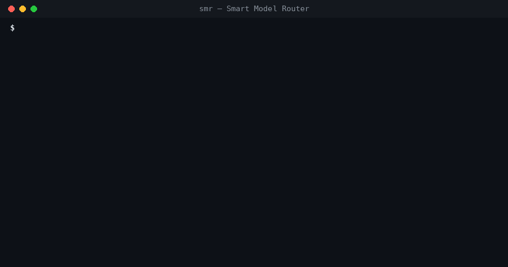

# Smart Model Router (SMR) Skill


**One task. Right model. Better results.**

[](https://github.com/i-smiling-buddha/smart-model-router-skill/actions/workflows/ci.yml)


[](https://github.com/i-smiling-buddha/smart-model-router-skill/stargazers)

> Use the cheapest model that can reliably complete the task — and escalate only when necessary.

SMR sits between you and your AI coding assistant. For every task it decides which model should
do it, checks that the work actually succeeded, and moves to a stronger model only when a cheaper
one fails. The goal is the **minimum cost per *successful* task**, not the minimum cost per token.

हिंदी गाइड: **[README.hi.md](README.hi.md)**



**Try it in 10 seconds** — works in Claude Code, Codex, Cursor, OpenCode and 40+ agents:

```bash
npx skills add i-smiling-buddha/smart-model-router-skill
```

## Features

- **Routing** — classifies each task (category, complexity 1–4, risk; understands English, Hindi and Hinglish) and scores every model on quality, fit, reliability, cost-per-success and speed. Critical tasks (security, payments, secrets, production data) have a reliability floor that cost can't override.
- **Verification** — runs only the checks a task needs (typecheck/lint/build → tests → requirement checklist). A README never triggers a test suite.
- **Escalation** — retry once, then move up a tier with a compact handoff (requirement, constraints, failure history; secrets redacted). Hard limits on retries, escalations and cost.
- **Learning** — every logged attempt adjusts the router's success estimates (Bayesian blend of prior and observed results per model × task type).
- **Token optimizer** — packs only relevant, deduplicated, compressed context under a budget (88–93% fewer tokens on this repo), caps output length from history, uses Anthropic prompt caching.
- **Benchmarks** — SMR vs a single model vs the best model; the verdict requires *no loss of success* **and** lower cost.
- **Dashboard** — self-contained HTML: savings vs always-best, cost by model, pass-rate heatmap, benchmarks, learning, recent tasks.
- **Works everywhere** — Claude Code, OpenCode, Codex, any MCP host (Cursor, VS Code agents…), a local HTTP API, or direct provider calls (Anthropic, OpenAI, OpenRouter, Gemini, Ollama).
- **Local-first** — the log lives in your project's `.smr/` folder. Nothing is uploaded anywhere.

## Install

### Option 1 — just the skill (any agent, no setup)

```bash
npx skills add i-smiling-buddha/smart-model-router-skill
```

Your agent learns to route each task to a fast, standard or advanced model, verify the result and
escalate only on failure. Nothing else to install.

### Option 2 — the full engine (`smr` CLI)

Adds logging, automatic verification, learning from results, benchmarks, the dashboard, an MCP
server and ready-made subagents for Claude Code / OpenCode / Codex.

**Windows (PowerShell):**

```powershell
git clone https://github.com/i-smiling-buddha/smart-model-router-skill
cd smart-model-router-skill
powershell -ExecutionPolicy Bypass -File scripts\install.ps1
```

**macOS / Linux:**

```bash
git clone https://github.com/i-smiling-buddha/smart-model-router-skill
cd smart-model-router-skill
sh scripts/install.sh
```

Requires Node.js 20+ (22.5+ recommended — enables the SQLite log). Full guide: **[docs/INSTALL.md](docs/INSTALL.md)**.

## Quick start

```bash
cd your-project
smr init claude-code      # or: smr init opencode / smr init codex
smr doctor                # checks Node, PATH, config, keys and the installed integration
```

Then just work in your assistant as usual (or say "use SMR"). In Claude Code the skill routes each
task to the `smr-fast` (Haiku), `smr-builder` (Sonnet) or `smr-architect` (Opus) subagent, verifies
it, escalates on failure, and a hook records token usage automatically.

`smr init` never overwrites your existing files; it lists what it skipped. On Windows it writes MCP
configs that launch `cmd /c smr mcp`.

## How hosts connect

| Host | What gets installed | Docs |
|---|---|---|
| Claude Code | skill + 3 subagents (haiku / sonnet / opus) + `.mcp.json` + SubagentStop hook | [docs/HOSTS.md](docs/HOSTS.md#claude-code) |
| OpenCode | `smr-router` primary agent + 3 subagents + `opencode.json` MCP | [docs/HOSTS.md](docs/HOSTS.md#opencode) |
| Codex | skill (`.agents/skills`) + 3 TOML agents + `.codex/config.toml` MCP + `AGENTS.md` | [docs/HOSTS.md](docs/HOSTS.md#codex) |
| Any MCP host | `smr mcp` — 12 tools (`smr_task_start`, `smr_verify`, `smr_route`, …) | [docs/HOSTS.md](docs/HOSTS.md#any-mcp-host) |
| Scripts / custom agents | `smr serve` (HTTP on 127.0.0.1) or `smr exec` (direct provider calls) | [docs/HOSTS.md](docs/HOSTS.md#http-api) |

> A skill can't silently change a host's main model. SMR delegates to subagents that each have
> their own model — the supported mechanism in Claude Code, OpenCode and Codex.

## Commands

| Command | Purpose |
|---|---|
| `smr route "<task>"` | Pick a model (with all candidate scores) |
| `smr task start / attempt / next / handoff / show` | Logged task lifecycle; retry/escalation from real history |
| `smr verify <id> --model <m>` | Run the checks the task needs, record the attempt, get the next action |
| `smr exec "<task>"` | Call the provider directly: route → call → verify → escalate, usage logged |
| `smr context "<task>" --dir src` | Pack only the relevant, compressed context under a token budget |
| `smr bench [suite] [--simulate] [--allow-code-exec]` | Benchmark SMR vs single model vs best model |
| `smr learn` · `smr report` · `smr dashboard` | What the router learned · usage · HTML dashboard |
| `smr mcp` · `smr serve` | MCP server (stdio) · local HTTP API |
| `smr init <host>` · `smr doctor` · `smr --version` | Setup and diagnostics |

Add `--json` to any command for machine-readable output.

## How routing works

```text
Score(m, t) = 0.35·Q + 0.25·S + 0.20·R + 0.10·C + 0.10·L        (smart mode)
```

`Q` quality (does the model clear what this task demands — capped, extra power earns nothing) ·
`S` right-sized fit · `R` reliability = p(success) · `C` cost efficiency = cheapest expected
cost-per-success ÷ this model's · `L` latency. Modes `economy` and `quality` shift the weights.
Details: **[docs/ARCHITECTURE.md](docs/ARCHITECTURE.md)**.

## Honest limitations

- **Model scores are initial estimates** until replaced by your own benchmarks and logged results — the Learning Engine does this over time.
- **Pricing is not built in.** Add current prices to a registry file to see USD (`smr.registry.example.json`); otherwise costs are relative units.
- **No real-API benchmark has been published yet.** Simulated benchmark output is always labelled as such. Run `smr bench --allow-code-exec` with your keys to measure for yourself.
- **Codex agent model names** (`gpt-5.4-mini`, `gpt-5.5`) must be checked against the models your Codex account offers.
- Automatic token capture is Claude Code only (hook). Elsewhere, tokens are recorded via `smr task attempt` / `smr_task_attempt`, or automatically by `smr exec`.

## Documentation

[Install](docs/INSTALL.md) · [Hosts](docs/HOSTS.md) · [Configuration](docs/CONFIG.md) · [Architecture](docs/ARCHITECTURE.md) · [Benchmarks](docs/BENCHMARKS.md) · [Security](SECURITY.md) · [Roadmap](docs/ROADMAP.md) · [Changelog](CHANGELOG.md) · [Contributing](CONTRIBUTING.md)

## More free skills by Smiling Buddha

- **[AI Image Recognition Skill](https://github.com/i-smiling-buddha/ai-image-recognition-skill)** — stop guessing from previews: your agent checks real transparency (catches fake checkerboards), true format, size/DPI, colors, blur and GPS metadata in the actual image file. `npx skills add i-smiling-buddha/ai-image-recognition-skill`

## Contributing

Issues, bug reports, benchmark results and pull requests are welcome. Please never paste API keys, `.env` contents or private code in public issues — `smr doctor` output is safe to share. Report security problems privately (see [SECURITY.md](SECURITY.md)). See [CONTRIBUTING.md](CONTRIBUTING.md) for guidelines.

## License

MIT. Made by [Smiling Buddha](https://github.com/i-smiling-buddha) · [DESITechnology](https://desitechnology.com).
